# HR Attrition Analysis: Orrin Digital

**Python (pandas, statsmodels, scikit-learn) · SQL (SQLite, point-in-time headcount from effective-dated history) · discrete-time survival model · flight-risk scoring with an out-of-time test · manager hot spots · cost of turnover and retention business case · Excel template · Power BI (DAX)**

Orrin Digital Ltd (fictional) is a UK software and IT services company with about 2,400 staff in Engineering, Data & AI,
Product & Design, Delivery, Customer Support, Sales & Marketing and Corporate Services, in London, Manchester, Edinburgh,
Belfast and remote. One in five people resigned in 2025. The people team wants to know **what attrition really costs,
what is driving it, who is likely to leave next, and which fix pays back**.

**Live summary page:** https://hr-attrition-analysis-beryl.vercel.app (source in [`site/index.html`](site/index.html))

**Hire me:** [Upwork profile](https://www.upwork.com/freelancers/~01da74f8f9f4611503) · Talha Ather, data analyst and ACCA student

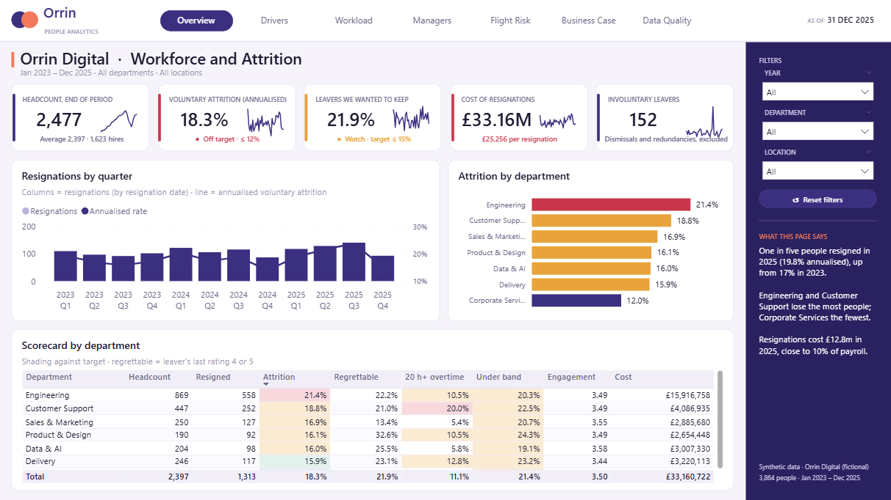

> **About the data.** The dataset is **synthetic**: 3,864 people employed at some point between Jan 2023 and Dec 2025,
> produced by a documented generator ([`scripts/generate_data.py`](scripts/generate_data.py)). It is a **month-by-month
> workforce simulation**: people are hired, paid, reviewed, promoted, managed and surveyed, and they resign with a known
> monthly probability. Pay bands move with the market faster than the pay review, some managers are poor managers, a
> return-to-office mandate lands in Sep 2024, a hiring freeze runs from Jan to Jun 2025 and Sales goes through a
> redundancy round. The HRIS export has the problems real ones have (department names spelled several ways, two date
> formats, salaries keyed as monthly figures, test records, leavers still marked Active, rehires under a new id,
> double-posted history rows). Because the generator records the truth ([`data_raw/true_effects.json`](data_raw/true_effects.json)),
> every cleaning step and estimate is **checked against it**.

## Key results

| | Result | So what |
|---|---|---|
| 1 | **Voluntary attrition rose from 17.3% (2023) to 19.8% (2025)**: 481 resignations on an average headcount of 2,429. At £26.6k each (recruitment, vacancy cover, ramp-up, team time), **resignations cost £12.8M in 2025, 9.6% of payroll**. About a quarter of leavers were people rated 4 or 5. | Attrition is a P&L line, not an HR statistic. |
| 2 | **The top three drivers: pay under 90% of band midpoint (odds of resigning ×2.14, 231 resignations over three years), 3+ years without a promotion (×1.75, 204) and overtime above 20 hours a month (×2.21, 144).** The model finds **the same top three as the generator's truth**; 11 of 12 true odds ratios sit inside its 95% intervals. | Pay drift, stalled careers and workload, in that order. |
| 3 | **The Jan-Jun 2025 hiring freeze backfired.** Vacancies rose from 2.2% to 6.5%, the share of staff on 20 h+ overtime from 6.5% to 37%, and resignations from 118 to 141 a quarter. **It saved £3.26M of salaries but cost £3.51M of extra overtime and £1.17M of resignations: £1.42M worse off.** | Freezing hiring is not a saving if the work stays. |
| 4 | **Exit interviews hide the real reasons.** "Better opportunity" is the top stated reason (34% of interviews), but 28% of those leavers were paid under band, 32% had waited 3+ years for promotion and 24% were on heavy overtime. Only 20 people named their manager. | Read exit interviews against the data. |
| 5 | **12 line managers lose people far faster than their teams' risk explains**: 83 extra resignations in three years. **11 of the 12 are truly poor managers in the generator**, found from outcomes alone; their teams also rate manager support 3.05 vs 3.83 elsewhere. | Coach or move a dozen managers. |
| 6 | **The return-to-office mandate cost people**: staff moved from remote to hybrid resigned at 30% over the next year vs 17-18% for everyone else (46 resignations caused). | Allow exceptions. |
| 7 | **The engagement survey is too weak to steer by**: a quarterly pulse that a fifth of staff skip, read a quarter late, recovers almost none of engagement's true effect (odds ratio 1.07 vs 1.6). But **silence is a signal**: people who stop answering resign 26% more often. | Measure engagement better; watch who goes quiet. |
| 8 | **Flight-risk scores, tested honestly** (scored Dec 2024, checked against 2025): the top 10% of scores resigned at 26% vs 18% on average and held 14% of leavers. **The generator's true formula on the same people reaches only 16%**: individual resignations are partly random. Today **247 people are in the High band (36 rated 4-5), £5.9M of replacement cost**. | Use the list to start conversations, not to decide. |
| 9 | **A retention package that pays back: staff to budget, lift pay to 90% of midpoint, hybrid exceptions and manager coaching. £1.07M a year, about 142 fewer resignations, £2.72M net benefit.** Promoting stalled people just to keep them does **not** pay (-£0.69M). | The CFO case, option by option. |

## Approach

| Step | Script | What it does |
|---|---|---|
| 1 | [`generate_data.py`](scripts/generate_data.py) | Month-by-month workforce simulation (hiring, pay reviews, bands, promotions, managers, overtime from vacancies, surveys, resignations from a known hazard), plus HRIS export problems |
| 2 | [`clean.py`](scripts/clean.py) | Cleans the extracts into SQLite (`orrin.db`): every fix logged in `dq_log` and **asserted** against the number injected (11 of 11 match); rebuilds **one row per person per month** (86,293) from the effective-dated job history: department, level, salary, band, pay position, manager, overtime, last rating, last survey answer |
| 3 | [`sql/analysis.sql`](sql/analysis.sql) | Thirteen people questions in SQL: headcount and attrition by year and department, the freeze by quarter, tenure, pay position, promotion, overtime, regrettable leavers, manager hot spots, return to office, new-hire retention, exit interviews vs data, survey silence. Results: [`sql/results.md`](sql/results.md) |
| 4 | [`drivers.py`](scripts/drivers.py) | Discrete-time hazard model (logistic regression on 84k person-months at risk); odds ratios vs the truth; resignations each driver caused; manager hot spots (actual vs expected, shrunk for small teams) |
| 5 | [`risk_model.py`](scripts/risk_model.py) | Flight-risk score (logistic regression vs gradient boosting) on monthly snapshots; **out-of-time test** on 2025; today's High band with the reasons |
| 6 | [`cost.py`](scripts/cost.py) | Cost of a resignation by level, cost of turnover by year, five retention options costed, the freeze's economics |
| 7 | [`excel_template.py`](scripts/excel_template.py) | Excel retention business case with live formulas (below) |
| 8 | [`export_powerbi.py`](scripts/export_powerbi.py), [`build_pbip.py`](scripts/build_pbip.py) | Star schema for Power BI and the dashboard as a Power BI Project |

Attrition rates are **annualised resignations ÷ average headcount** (person-months ÷ 12). Dismissals and the Mar 2025
redundancy round are involuntary and are kept out of the driver analysis.

### Data quality

| Problem in the HRIS export | Rows | Injected | Fix |
|---|---:|---:|---|
| History events posted twice | 18 | 18 | removed |
| Test / sandbox employee records | 6 | 6 | removed |
| Department spelled several ways (history / master) | 573 / 152 | 573 / 152 | mapped to the 7 official names |
| Hire date as dd/mm/yyyy | 569 | 569 | parsed day-first |
| Gender coded several ways (F, female, PNTS ...) | 379 | 379 | standardised |
| Salary keyed as a monthly figure | 76 | 76 | ×12, checked against the job history |
| Leaver still marked Active | 9 | 9 | set to Terminated |
| Manager id blank (the history has it) | 38 | 38 | filled from the history |
| Timesheet missing for the month | 3,442 | 3,442 | overtime averaged over the months that exist |
| Negative overtime (payroll reversals) | 166 | 166 | set to missing |
| Rehired under a new id (same name and date of birth) | 63 | 63 rehires | linked (the HRIS had linked only 25) |

## Drivers: what makes people resign

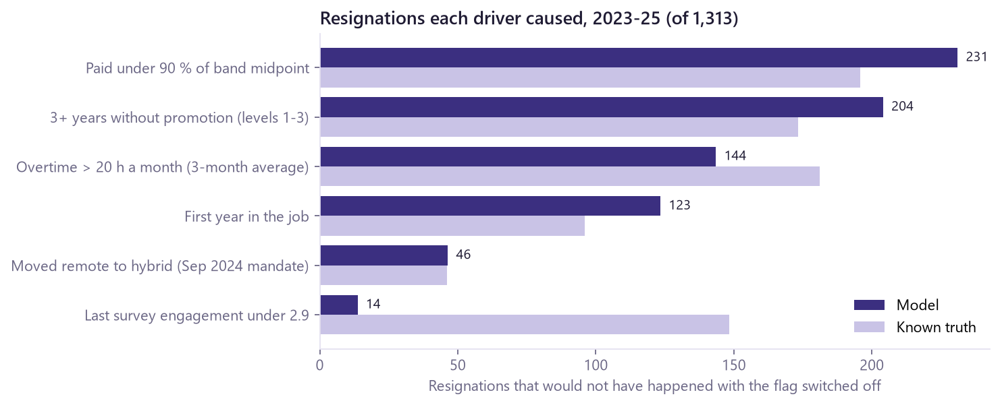

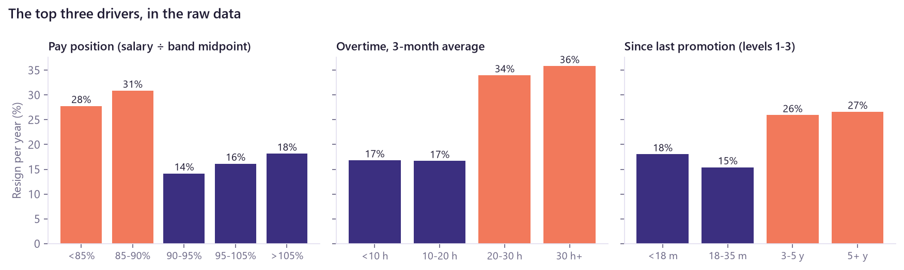

Discrete-time logistic regression: monthly P(resign) on 84,281 person-months at risk (1,313 resignations), with
department, month-of-year and the 2023 tech hiring market as controls.

| Effect | Share of months | Odds ratio | 95% CI | True |
|---|---:|---:|---:|---:|
| Overtime > 20 h a month (3-month average) | 11% | 2.21 | 1.91-2.55 | 2.41 |
| Paid under 90% of band midpoint | 21% | 2.14 | 1.88-2.43 | 1.90 |
| 3+ years without promotion (levels 1-3) | 26% | 1.75 | 1.53-2.00 | 1.60 |
| Moved remote to hybrid (Sep 2024) | 5% | 1.77 | 1.44-2.19 | 1.70 |
| First year in the job | 19% | 1.68 | 1.44-1.97 | 1.51 |
| Last survey engagement under 2.9 | 13% | 1.07 | 0.92-1.25 | 1.60 ✗ |

The one miss is engagement: the truth uses each person's real engagement, the analysis only sees a noisy, quarterly,
partly unanswered survey. That is the finding: **as designed, the survey cannot carry the signal**.

## Workload and the hiring freeze

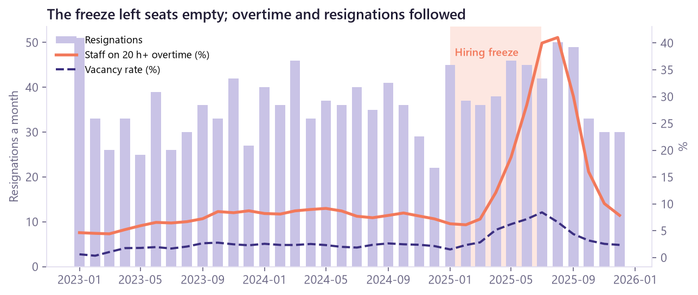

## Managers

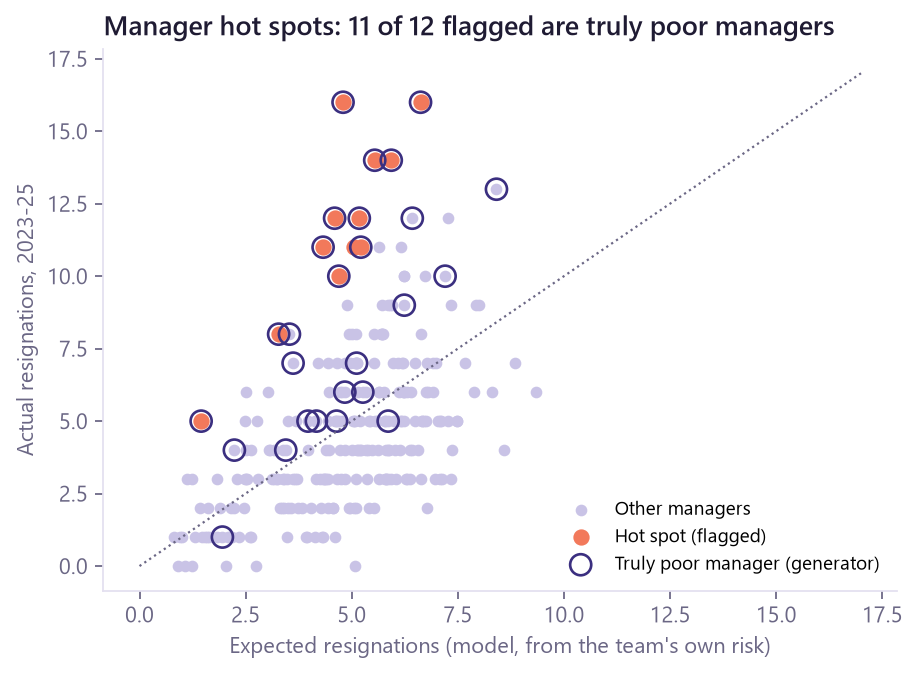

Each manager's actual resignations (levels 1-3 in the team) against what the model expects for those people. Ratios
are shrunk toward 1 for small teams; a hot spot is 1.6× or more with 60+ person-months. 12 flagged, 11 of them truly
poor managers in the generator (precision 92%; they are 11 of the 27 poor managers with enough data, so recall is 41%:
a poor manager with a small or short-lived team cannot be told apart from bad luck).

## Flight risk

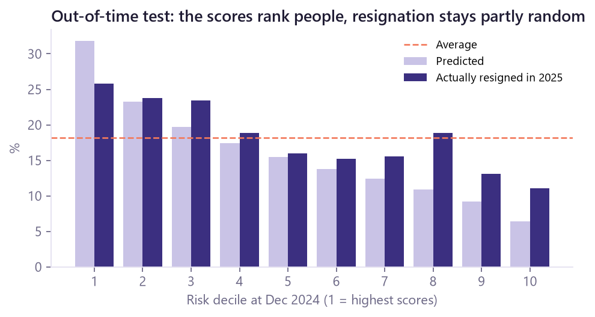

| 2025 test (scored Dec 2024) | Logistic regression | Gradient boosting | True formula (ceiling) |
|---|---:|---:|---:|
| AUC | 0.583 | 0.585 | 0.619 |
| Top 10% of scores: resigned | 25.9% | 26.7% | 29.6% |
| Top 10% of scores: share of all leavers | 14.2% | 14.7% | 16.3% |

The logistic model is kept: it is as accurate as boosting, better calibrated and explainable. The "ceiling" applies the
generator's own formula (including the hidden poor-manager flag) to the same people: even a perfect model cannot know who
will resign, only who is more likely to. Each High-band person comes with the reasons (pay position, overtime, years
since promotion, manager's team, first year, office move, low engagement) in the dashboard and the Excel template.

## Retention business case

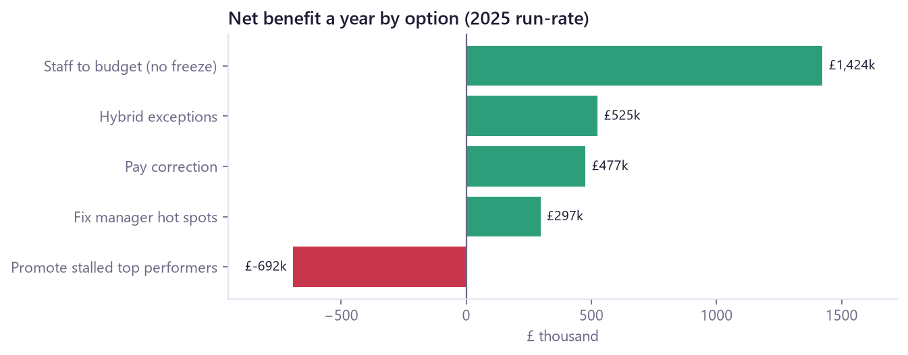

| Option | People | Resignations avoided a year | Annual cost | Net benefit a year |
|---|---:|---:|---:|---:|
| Staff to budget (no freeze) | | 45 | -£0.26M (salaries saved minus overtime) | **£1.42M** |
| Hybrid exceptions for people moved off remote | 196 | 18 | £0 | **£0.53M** |
| Lift everyone under 90% of band midpoint to 90% | 373 | 64 | £1.25M | **£0.48M** (ROI 38%) |
| Coaching or re-assignment for the 12 hot-spot managers | 12 | 14 | £0.07M | **£0.30M** (ROI 412%) |
| Promote stalled people rated 4-5 (10% rise) | 198 | 18 | £1.24M | -£0.69M |

Avoided resignations = resignations among the people affected × (OR − 1) / OR (the share the driver causes) × the share
of the problem the option removes. Cost of a resignation: recruitment 12-30% of salary, 2-4 months of vacancy cover and
3-9 months of ramp-up at 50% of pay, plus team time: 37% of salary for an associate to 92% for a head of department.

## Excel retention business case

[`excel/Orrin_retention_business_case.xlsx`](excel/Orrin_retention_business_case.xlsx): **every number is a live formula**.
Inputs (blue) hold the cost of a resignation by level, on-costs, overtime premium, promotion rise, coaching cost and the
target pay position; Scenarios turns resignations avoided, benefit, cost, net, ROI and payback into formulas off those
inputs, with a "share of the problem removed" lever per option; Pay gap lists the 373 people under 90% of midpoint with
the rise to target; Flight risk holds the 247 High-band people with the reasons and what losing each would cost. The
Summary picks every option with a positive net benefit. Recalculated in Excel with 0 errors; matches the Python results
to the pound (rounding of the cost shares aside).

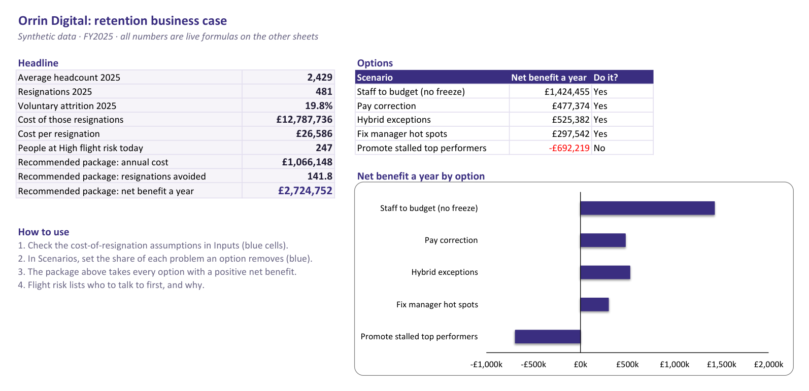

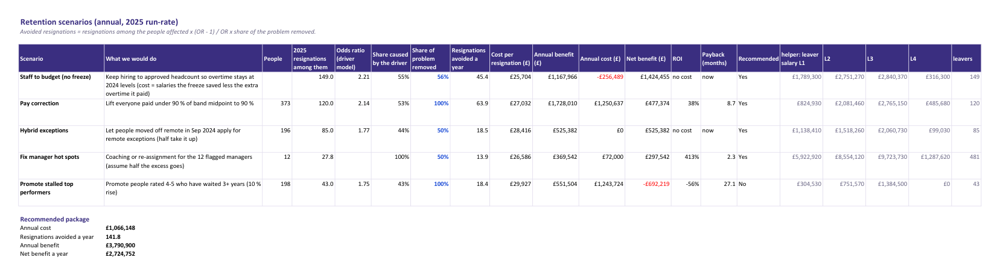

## Power BI dashboard

Seven pages in a light **"Orrin People"** design made for this company: a pale lavender canvas, a white header with pill
tabs, white cards, deep indigo as the lead colour, lavender second, and coral kept for risk. Filters (Year, Department,
Location, synced across pages, one-click reset) sit in an indigo rail on the right with a short "what this page says"
note. KPI tiles carry a status-coloured edge (green / amber / red against targets) and a monthly trend line. An
**Employee Detail** drill-through and an employee tooltip hang off the flight-risk list. Orrin is fictional, so the
palette is a proposed identity, not an official brand. Details: [`powerbi/DESIGN.md`](powerbi/DESIGN.md).

| Overview | Drivers |
|---|---|
|  | 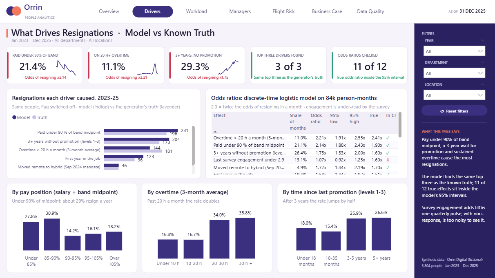 |
| **Workload** | **Managers** |
| 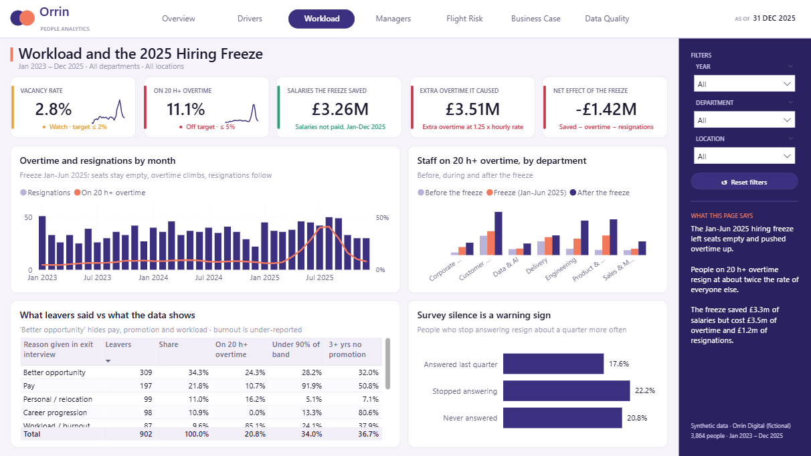 | 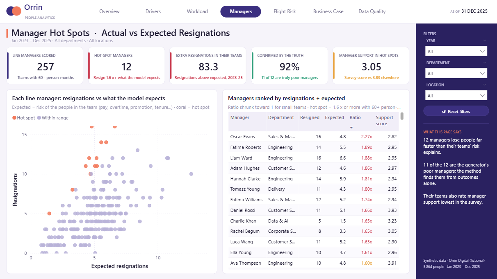 |
| **Flight Risk** | **Business Case** |
| 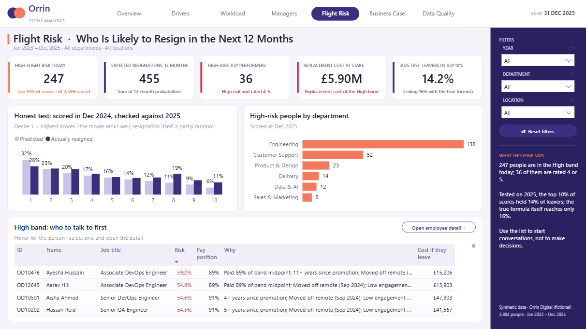 | 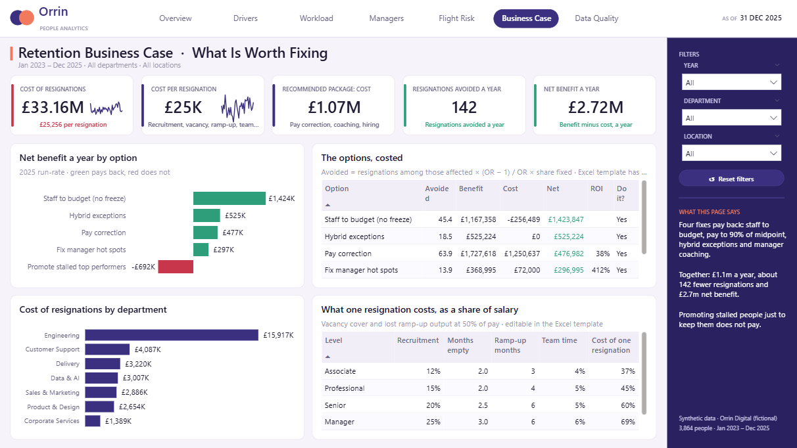 |
| **Data Quality** | **Employee Detail** (drill-through) |
| 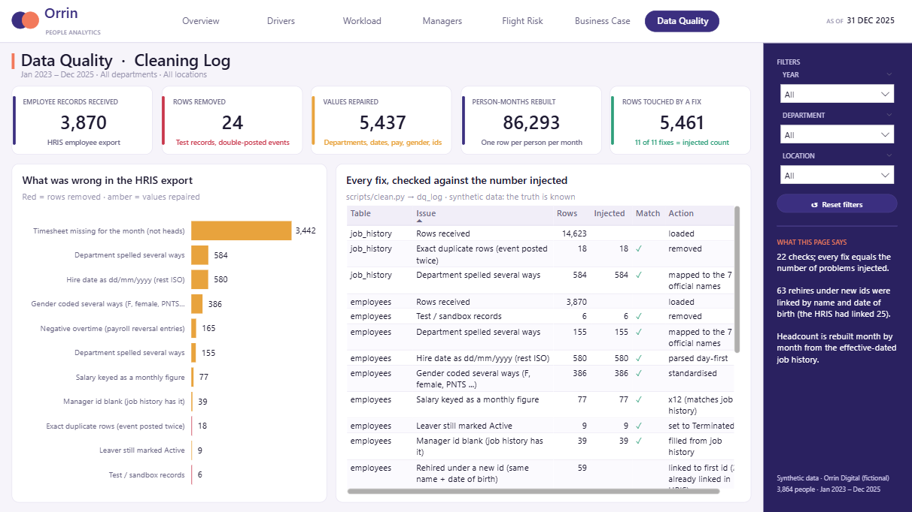 | 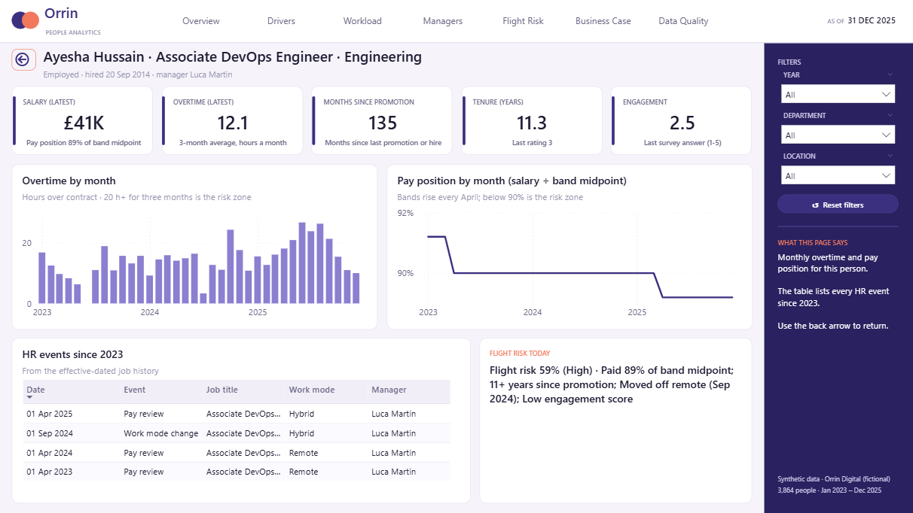 |

The model (20 tables, 176 measures, 14 relationships) was refreshed in Power BI Desktop and its totals checked against
SQL and Python with DAX queries.

## Run it

```
pip install -r ../requirements.txt
python scripts/generate_data.py     # synthetic data + truth
python scripts/clean.py             # SQLite + cleaning log + person-month table
python scripts/run_sql.py           # sql/results.md
python scripts/drivers.py           # driver model, manager hot spots
python scripts/risk_model.py        # flight-risk model and test
python scripts/cost.py              # cost of turnover, scenarios
python scripts/excel_template.py    # Excel business case
python scripts/make_charts.py       # README charts
python scripts/export_powerbi.py    # Power BI tables
python scripts/build_pbip.py        # powerbi/Orrin.pbip
```

Open `powerbi/Orrin.pbip` in Power BI Desktop and click Refresh. If the project folder moves, update the `DataFolder`
parameter (Transform data → Manage parameters).

## Folders

- `data_raw/` the synthetic HRIS export and the truth
- `data_clean/` cleaned outputs, model results, `powerbi/` tables (`orrin.db` is rebuilt by `clean.py`)
- `sql/` queries and results
- `scripts/` everything above, re-runnable
- `excel/` the business-case template
- `powerbi/` the Power BI Project and its theme
- `images/` charts and screenshots
- `site/` one-page summary
